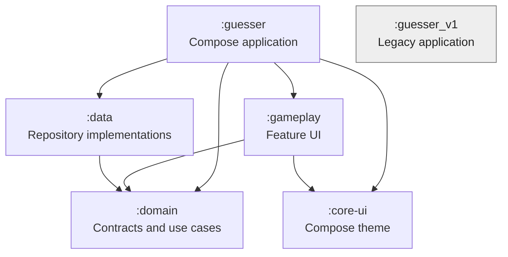
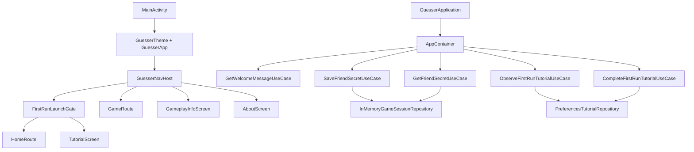
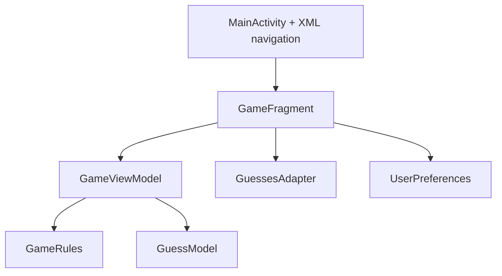

# Architecture

## Repository Shape

Guesser is now a multi-module Android repository with two independent
applications. The Compose revamp is the primary product direction; Guesser V1
is retained as an isolated reference and playable fallback.

There is deliberately no dependency edge between the revamp modules and
`:guesser_v1`.

## Module Responsibilities

| Module | Type | Responsibility |
| --- | --- | --- |
| `:guesser` | Android application | Application object, activity, composition root, and Navigation Compose host |
| `:gameplay` | Android library | Home UI/state plus Game, Tutorial, Gameplay, and About destinations |
| `:domain` | Kotlin/JVM library | Repository interfaces, thin use cases, and pure game rules (`GuessRules`) |
| `:data` | Android library | App-info, in-memory game-session, and Preferences DataStore tutorial repositories |
| `:core-ui` | Android library | Material 3 colors, typography, and `GuesserTheme` |
| `:guesser_v1` | Android application | Complete legacy XML/View game, physically located in `app/` |

`settings.gradle` maps project `:guesser_v1` to directory `app`; directory and
Gradle project names therefore differ intentionally.

## Revamp Runtime Assembly

`GuesserApplication` lazily creates one `AppContainer`. The container performs
manual dependency injection by obtaining repositories from `RepositoryModule`
and constructing use cases. `MainActivity` enables edge-to-edge drawing and
sets Compose content. `GuesserApp` creates the navigation controller.

No dependency-injection framework is used.

## Navigation

`GuesserNavHost` owns six user-facing routes and a launch-gate route:

| Route | Destination | Current status |
| --- | --- | --- |
| `launch_gate` | `FirstRunLaunchGate` | Reads saved onboarding completion before opening Tutorial or Home |
| `settings` | `SettingsRoute` | Music and sound-effect toggles, opened from Home or Game |
| `home` | `HomeRoute` | Implemented |
| `game` | `GameRoute` | Implemented: keypad, guess board, scoring, leave/quit-reveal/win dialogs, help, settings, sound and confetti |
| `tutorial?firstRun={firstRun}` | `TutorialScreen` | Three swipeable steps, isolated practice, onboarding or manual entry |
| `gameplay_info` | `GameplayInfoScreen` | Visual rules, examples, modes, controls, strategy |
| `about` | `AboutScreen` | Story, credits, runtime version, public source/license links |

Forward and backward navigation use 320 ms horizontal slide transitions. The
home Start handler saves either the valid Double Player secret or `null` for
Single Player before navigating to `game`.
First-run completion is stored by `PreferencesTutorialRepository`; Skip,
Get Started, and Back from the first page all mark onboarding complete.

## Revamp State Ownership

| State | Owner | Lifetime |
| --- | --- | --- |
| Selected player mode | `HomeViewModel` / `HomeUiState` | Home navigation entry/ViewModel |
| Friend secret input | `HomeViewModel` / `HomeUiState` | Home navigation entry/ViewModel |
| Validation message | `HomeViewModel` / `HomeUiState` | Home navigation entry/ViewModel |
| Handed-off friend secret | `InMemoryGameSessionRepository` | `AppContainer` / application process |
| Round secret, guesses, input, dialogs | `GameViewModel` / `SavedStateHandle` | Game navigation entry, including process recreation |
| Navigation back stack | `NavHostController` | Compose activity instance |
| Music and sound-effect settings | `PreferencesSettingsRepository` (DataStore) | Across launches |
| Sound pool and music player | `GuesserAudio` in `AppContainer` | Application process; music paused while the activity is stopped |

`HomeUiState` and `GameUiState` are exposed as read-only `StateFlow`s and
collected with lifecycle awareness. Only the Game round uses
`SavedStateHandle`. There is no database or cross-launch game persistence.
Tutorial completion and audio settings share one Preferences DataStore file
(`guesser_preferences`) through a single delegate in `GuesserPreferences.kt`.

## Audio

`GuesserAudio` (`:gameplay/audio`) loads the short WAV effects in
`gameplay/src/main/res/raw` into a `SoundPool` and loops
`music_background.ogg` with `MediaPlayer` (fading in). `MainActivity` collects
`ObserveAudioSettingsUseCase` while started and tells `GuesserAudio` whether
the app is in the foreground, so music never plays in the background. It
provides `GuesserAudio` to Compose as `LocalGameSoundPlayer`; previews fall
back to silence. Components use `rememberTapFeedback` for a sound plus a
`KEYBOARD_TAP` haptic. The sounds are synthesized by
`design_assets/audio/make_audio.py`.

The app-info repository and welcome-message use case are wired and invoked
during `HomeViewModel` initialization, but the returned string is not currently
stored or rendered.

## Home UI

The home screen:

- uses full-screen Compose with edge-to-edge system bar padding;
- keeps only the wood background and title as drawable assets;
- draws buttons, mode toggle, and secret input with Compose gradients/borders;
- uses `BoxWithConstraints` width fractions with tablet caps and height scaling;
- scrolls vertically and applies IME padding for compact displays;
- constrains mode interaction to two selectable radio-button regions;
- masks Double Player secret input;
- uses pressed scale/darken feedback at runtime.

Original design files are preserved under `design_assets/raw_assets`. Runtime
resources are copied and normalized separately so source artwork is not a
module dependency.

## Shared UI

`:core-ui` supplies a Material 3 theme with static light/dark fallback schemes
and Android 12+ dynamic color enabled by default. `GuesserScreenScaffold`
provides the wood background and safe-area padding for secondary destinations.
`GuideScaffold` adds a 520 dp reading-width cap, scrollable content, and a
48 dp gold-framed auto-mirrored back control. `GuideComponents` reuses Game's
wood panels, tiles, and remark boxes with text descriptions for each clue.
Tutorial practice state is local `rememberSaveable` state, not a Game ViewModel
or session repository. First-run completion is a separate Preferences DataStore
value behind the domain `TutorialRepository`; the launch gate waits for that
value before choosing Tutorial or Home. Skip/Get Started and system Back from
the first tutorial page save completion. Manual Tutorial remains available.
Its Play action clears the friend secret and replaces Tutorial with Game;
Gameplay help only pops back to the existing round.

## Application Boundaries

The revamp application ID is `io.keval.apps.guesser`; the V1 application ID is
`com.thekeval.guesser`. Both target SDK 36, require API 21 or later, use Java
17, and are locked to portrait orientation.

## Guesser V1 Architecture

V1 remains a single-activity, fragment-based MVVM-style application:

It retains XML layouts, LiveData, ViewModel, `SharedPreferences`, custom keypad
logic, audio/haptic feedback, and the complete scoring loop. This code should
remain isolated unless a change is specifically intended for V1.
