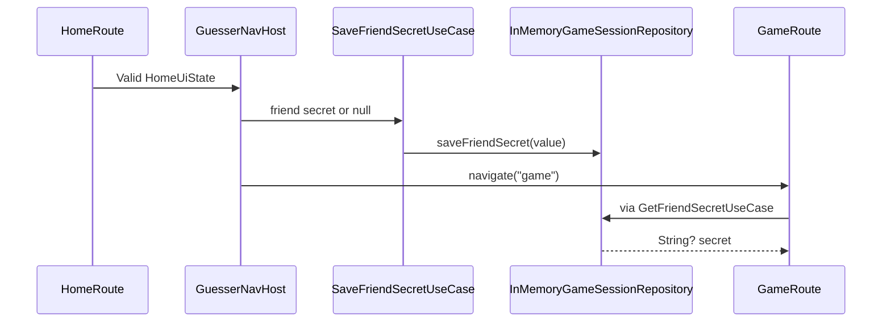

# Implementation Guide

## Revamp Startup

The new application starts through four small composition layers:

1. Android creates `GuesserApplication`.
2. Its lazy `AppContainer` creates repository implementations and use cases.
3. `MainActivity` enables edge-to-edge rendering and applies `GuesserTheme`.
4. `GuesserApp` creates a `NavHostController` and calls `GuesserNavHost`.

The application layer depends on all four support modules and is the only
place that assembles concrete `:data` repositories with `:domain` use cases.

## Manual Dependency Container

`RepositoryModule` constructs:

- `DefaultAppInfoRepository`, which returns `"Welcome"`;
- `InMemoryGameSessionRepository`, which holds one nullable friend secret.

`AppContainer` exposes:

- `GetWelcomeMessageUseCase`;
- `SaveFriendSecretUseCase`;
- `GetFriendSecretUseCase`.

These abstractions establish replaceable boundaries but are intentionally
minimal. The welcome result is currently discarded, and the session
repository has no clear/consume operation beyond saving `null`.

## Home State and Validation

`HomeUiState` contains:

```text
playerMode: SINGLE | DOUBLE
friendSecretNumber: String
secretValidationMessage: String?
```

`HomeViewModel` owns a `MutableStateFlow` internally and exposes an immutable
`StateFlow`.

### Mode Changes

Selecting Single Player clears the friend secret and any validation message.
Selecting Double Player preserves a previously entered secret and clears the
message.

### Secret Input

`onFriendSecretNumberChanged` filters input to ASCII `0`-`9` (`isCodeDigit`) and keeps
at most three characters. Empty input shows no live error. Non-empty values
are validated with duplicate detection before length detection, so `11`
reports `Digits must be unique`.

### Starting

`canStartGame` always accepts Single Player and clears validation. Double
Player calls the same validator used during typing and accepts only three
unique digits.

`HomeRoute` invokes the outer Start callback only after `canStartGame` returns
true.

## Home Compose UI

`HomeScreen` is stateless: it renders `HomeUiState` and emits callbacks.
`HomeRoute` is the stateful boundary that creates the ViewModel and collects
state with `collectAsStateWithLifecycle`.

Notable implementation details:

- `BoxWithConstraints` drives width fractions, tablet caps, and proportional
  down-scaling for short-height screens;
- `verticalScroll`, status/navigation bar padding, and `imePadding` support
  compact layouts;
- player mode, Start, and secondary buttons are drawn in Compose with gradients
  and rounded-pill borders (only background/title remain image assets);
- the mode selector uses an animated selected segment and two `selectable`
  radio-button regions;
- the friend secret uses `BasicTextField`, numeric-password keyboard options,
  and `PasswordVisualTransformation`;
- buttons collect press state and scale/darken to pressed feedback without a
  ripple;
- accessibility descriptions for home controls come from string resources.

## Session Handoff

The home destination does not pass a secret in a navigation route:



Single Player stores `null`; Double Player stores the validated secret.
`GameRoute` passes the retrieved value into `GameViewModel`, which uses it as
the round secret (or generates one when absent) and never displays it until
the round is won. The repository is process-memory only.

## Game Screen

- `GuessRules` (`:domain`, package `domain.game`) validates codes, generates
  unique secrets, and evaluates a guess into per-digit `DigitFeedback`
  (`EXACT`, `CLOSE`, `ABSENT`) plus the V1 remark string.
- `GameViewModel` owns the secret, submitted guesses, current input, and dialog
  flags. These are stored in `SavedStateHandle`, so they survive rotation,
  process death, and navigating to Help and back. It exposes `GameUiState` as
  a `StateFlow`.
- `GameRoute` collects state, handles system back with `BackHandler`, and
  delegates to a stateless `GameScreen`. A horizontal drag past 96 dp
  (`swipeToGoBack`) calls the same back request; the content follows the
  finger by up to 48 dp and springs back.
- Quit calls `onQuitRequested` (confirmation), then `onConfirmQuit`, which sets
  `isGivenUp`, reveals the secret, locks input, and is saved in
  `SavedStateHandle`. `QuitRevealDialog` flips the secret tiles in and returns
  Home when closed.
- `GuessResultFeedback` plays a flip tick per tile, then the SMYLE jingle or
  clue chime when the remark pops in (`REMARK_REVEAL_DELAY_MS`). A saveable
  guess count stops the result replaying after Help or Settings. The win
  dialog is full-window so `ConfettiBurst` (`Confetti.kt`, frame-driven
  analytic physics) can cover the screen; it plays applause on entry.
- `GameScreen` sizes everything from `BoxWithConstraints`. Tile size is the
  smaller of a width fit and a height fit that keeps at least five rows
  visible. Keypad keys scale with width and height, and content is capped at
  520 dp on tablets.
- `GameComponents` provides the `WoodPanel` (gold frame over a cropped wood
  texture), `DigitTile` with a staggered flip reveal, `RemarkBox`, `KeypadKey`,
  and `GuesserDialogFrame`. These reuse the Home palette.
  `DigitTile` retains the original feedback-to-color mapping behind
  `colorFeedbackEnabled` (true by default for learning examples).
  `GameScreen` passes false: tile fronts (empty, typed, and the first half
  of the reveal flip) keep the neutral yellowish brush, and every flipped
  (analysed) tile shows gray with light digits. Evaluations, remarks, and win
  detection are unchanged.
- `RemarkBox` renders `SMYLE` with a teal fill and border. With
  `animateHeartbeat` (set for the just-revealed row) it scales through a
  one-time "lub-dub" pulse. `RemarkInfoIcon` trims font padding so the "i"
  is optically centered.
- `RemarkInfoIcon` sits in a reserved `INFO_UNITS` column beside each
  remark. The remark box and icon share one clickable row (well above the
  48 dp minimum touch target). While the popup is open, the game content uses
  `clearAndSetSemantics {}` so accessibility services see only the popup,
  which is announced through `paneTitle`. `GameScreen` holds the selected `GuessEvaluation` and shows
  `RemarkInfoPopup`, an in-window overlay animated with `AnimatedVisibility`
  (scrim fade; card `scaleIn` from 1.18 with fade, `scaleOut` to 0.92 on
  dismiss). `GuessEvaluation.remarkMeaning()` (`RemarkMeaning.kt`) maps a
  guess to Winner, SMYLE, or R/W counts, rendered with plural strings.
- `game_board_wood` and `game_keypad_wood` are textures cropped from the home
  background and drawn with `ContentScale.Crop`, so they never stretch.

## Navigation and Learning Screens

`GuesserNavHost` starts at a launch gate that reads the first-run tutorial
completion flag from Preferences DataStore, then routes to Tutorial or Home.
Skip, Get Started, and first-step system Back complete onboarding before
opening Home; the persisted flag prevents it from returning on later launches.
Home can still open Tutorial manually. The host declares Home, Game, Tutorial,
Gameplay, and About routes with horizontal slide transitions. These learning
destinations use
`GuideScaffold`, built on `GuesserScreenScaffold` with a gold-framed back
control, scrollable content, and 520 dp maximum width.

Game exits by popping back to Home. Its help button, shown only when
`GAMEPLAY_GUIDE_ENABLED` (`navigation/GameplayRoutes.kt`) is true, navigates
to Gameplay (`launchSingleTop`) and leaves Game on the back stack. The flag is
currently false, which also hides Home's GAME PLAY button; the Game header keeps
the help slot empty so the title stays centered.

`GuideComponents` shares wood panels, readable headings/body text, wrapping
Material buttons, and scored digit/remark examples. Example rows announce
each digit's feedback as well as the remark. Static examples reveal immediately,
without entrance animations or repeated motion.

`LearningExamples` evaluates the reference guesses through `GuessRules`.
`TutorialScreen` uses a horizontally swipeable pager with three accessible
progress dots and explicit Back/Next actions. Practice state is saved with
`rememberSaveable`; practice uses the existing keypad and digit tiles but no
real round state. It shows submitted guesses with
`GuideGuess(colorFeedbackEnabled = false)`: gray tiles and a remark-only
announcement, matching real rounds. Gameplay examples keep the default colors. First-run Skip/Get Started/system Back completion is stored
through `TutorialRepository` and `PreferencesTutorialRepository`. Manual
Tutorial Back moves through pages and then returns Home. **PLAY NOW** saves a
null friend secret and replaces Tutorial with Game, starting Single Player.

The clue-rules page (step 2) is wrapped in `FitToHeight` (`common/FitToHeight.kt`)
so it shows without scrolling. A `SubcomposeLayout` measures the page at its natural
size and, if it overflows, binary-searches the largest zoom that fits; text,
spacing and badges shrink together and text re-wraps. The zoom never takes body
text below 13 sp or removes more than a quarter of the player's font size. If the
page cannot fit at that floor (very small screens or large accessibility font
sizes), it keeps its natural size and scrolls, so nothing is clipped. It is used
only for non-interactive content because zooming also shrinks touch targets.

The practice keypad switches to three columns on narrow panels to keep digit
targets at least 48 dp wide. Submitted clues use a polite live-region
announcement. Compact, large-text, and tablet previews are included.

`GameplayInfoScreen` is a rules reference with examples, controls, modes, and
strategy. `AboutScreen` reads the installed version through PackageManager and
opens the public repository and Apache license externally, with an explicit
message when no link-handling application is installed. All screen copy is
in `gameplay/src/main/res/values/strings.xml`; each screen has a Compose preview.

## Theme and Assets

`:core-ui` defines `GuesserTheme`, colors, and default Material typography.
Android 12+ dynamic color is enabled unless a caller opts out. The wood-screen
learning-screen foreground colors use explicit cream/gold over dark wood
panels so content remains legible regardless of the dynamic scheme.

Source artwork lives in `design_assets/raw_assets`. Runtime-sized copies live
in `gameplay/src/main/res/drawable-nodpi` for the background, title, and the
two Game wood textures. Buttons, tiles, and keys are Compose-drawn, so they
stay crisp across screen sizes and densities.

## Revamp Tests

- `HomeViewModelTest` covers duplicate-message consistency, empty-on-type
  versus required-on-start behavior, and valid Double Player setup.
- `GetWelcomeMessageUseCaseTest` verifies repository delegation.
- `GuessRulesTest` covers validation, generation, and the full remark table.
- `GameViewModelTest` covers input guards, scoring, winning, exit
  confirmation, play-again, and `SavedStateHandle` restoration.
- `RemarkMeaningTest` checks remark-to-meaning mapping for every remark type.
- `LearningExamplesTest` verifies displayed remarks and exhaustively checks
  the tutorial's deduction against every valid code consistent with its clues.

There are no current Compose UI, navigation, repository, or instrumentation
tests.

## Guesser V1 Implementation

The complete game remains under `app/` as `:guesser_v1`:

- `GameRules` validates codes, generates unique secrets, and produces remarks.
- `GameViewModel` owns the secret, guess history, and four-state round machine.
- `GameFragment` handles rendering, dialogs, custom keypad input, layout,
  sound, vibration, animations, and confetti.
- `GuessesAdapter` renders newest-first immutable guess rows.
- `UserPreferences` persists result sound, keypad sound, and vibration options.

V1's scoring computes right-position matches, total overlap, and then
wrong-position matches as `overlap - right`. That implementation assumes both
inputs already satisfy the unique-three-digit contract.

V1 is not a shared library and is not imported by the revamp. Reusing its
rules requires intentionally porting the behavior into the new domain model,
not depending on `:guesser_v1`.
